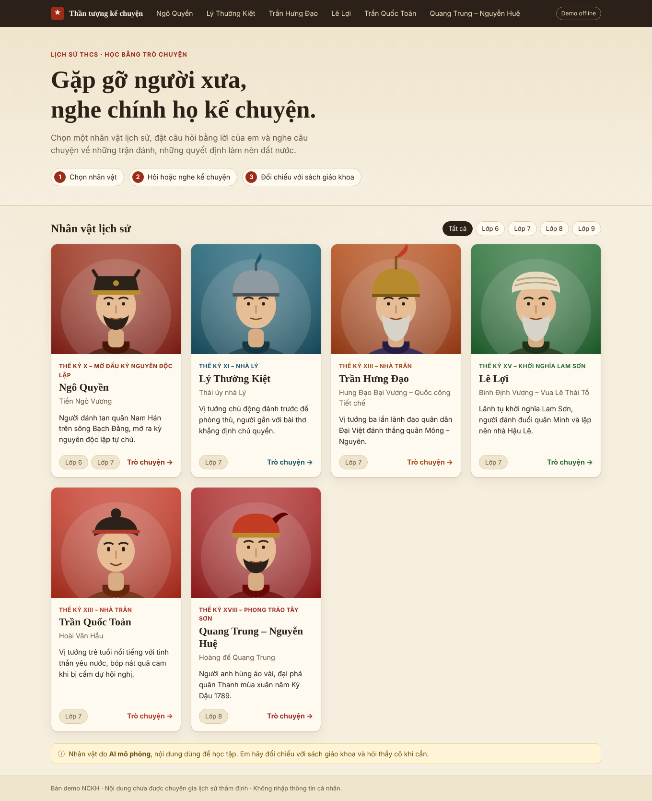

# Thần tượng kể chuyện – Nhân vật lịch sử ảo (bản demo)

Website cho học sinh THCS trò chuyện và nghe kể chuyện cùng nhân vật lịch sử do AI mô phỏng.
Đây là **bản demo (Phase P0)** dựng theo tài liệu SRS của đề tài NCKH.

> **Chạy hoàn toàn miễn phí, không cần mạng hay khoá API.** Mặc định ứng dụng trả lời từ kho tri thức soạn sẵn
> (chế độ `mock`). Khi có khoá Gemini miễn phí, chỉ cần điền vào `.env` để chuyển sang AI thật.



## Chạy nhanh

Yêu cầu: **Node.js 20+**.

```bash
npm install          # cài cho cả server và client
npm run dev          # server http://localhost:4000, client http://localhost:5173
```

Mở http://localhost:5173. Góc phải thanh trên cùng hiện **Demo offline** (chế độ mock) hoặc **AI trực tuyến** (Gemini).

Chạy kiểu production (một cổng duy nhất):

```bash
npm run build        # build client vào client/dist
npm start            # server phục vụ cả API và giao diện tại http://localhost:4000
```

Kiểm thử: `npm test` (15 test, dùng `node:test`, không cần cài thêm).

## Hai chế độ AI

| Chế độ | Khi nào | Chi phí | Ghi chú |
|---|---|---|---|
| `mock` (mặc định) | Không có `GEMINI_API_KEY` | 0 đồng | Trả lời bằng FAQ/sự kiện soạn sẵn, từ chối khéo khi ngoài kho tri thức |
| `gemini` | Có `GEMINI_API_KEY` | Gói miễn phí có giới hạn | Persona prompt + kho tri thức; lỗi thì tự rơi về `mock` |

Bật Gemini: sao chép `.env.example` thành `.env`, điền `GEMINI_API_KEY`, chạy lại server.
Khoá **chỉ nằm ở server**, không bao giờ gửi xuống trình duyệt.
Gói miễn phí có thể dùng dữ liệu để cải thiện sản phẩm, vì vậy chỉ dùng để demo và không nhập thông tin cá nhân.

## Cấu trúc thư mục

```
than-tuong-ke-chuyen/
├─ client/                  Giao diện React (Vite)
│  ├─ public/characters/    Ảnh chân dung minh hoạ (SVG, ảnh tạm)
│  └─ src/
│     ├─ pages/             Home, CharacterPage
│     ├─ components/        ChatWindow, StoryPlayer, ProfilePanel, CharacterCard, Disclaimer
│     ├─ hooks/useSpeech.js Đọc thành tiếng + nhập bằng giọng nói
│     └─ api.js             Gọi API
├─ server/                  API Node/Express
│  ├─ src/
│  │  ├─ routes/            characters, chat, story, feedback
│  │  ├─ services/          guardrail, retrieval, llm (mock | gemini), characterStore
│  │  ├─ middleware/        (dành cho auth/quản trị ở giai đoạn sau)
│  │  └─ data/characters/   6 nhân vật dạng JSON (persona, hồ sơ, sự kiện, FAQ)
│  └─ tests/                Test guardrail và API
├─ scripts/                 generate-avatars.mjs
├─ docs/                    ARCHITECTURE.md, DEMO.md, screenshots/
├─ .env.example
└─ package.json             npm workspaces: server + client
```

## Phạm vi demo so với SRS

| Mã SRS | Tính năng | Trạng thái demo |
|---|---|---|
| UC-01/02, FR-CHR | Danh sách và chọn nhân vật, lọc theo lớp | Có (6 nhân vật) |
| UC-10, FR-CHAT | Hỏi đáp theo vai, câu hỏi gợi ý, lịch sử hội thoại | Có |
| UC-11/12, FR-VOI | Nghe kể chuyện, đọc từng câu có tô sáng | Có (giọng trình duyệt) |
| FR-VOI-04 | Nhập câu hỏi bằng giọng nói | Có (nếu trình duyệt hỗ trợ) |
| UC-13 | Hồ sơ nhân vật | Có |
| UC-36 | Phản hồi 👍/👎 kèm lý do | Có (ghi log, chưa lưu CSDL) |
| BR-09 | Luôn hiển thị "AI mô phỏng" | Có |
| FR-SAFE, UC-40 | Chặn prompt injection, nội dung không phù hợp, che SĐT/email | Có |
| BR-01 | Không bịa khi ngoài kho tri thức | Có |
| FR-SAFE-06 | Giới hạn tần suất | Có (20 lượt / 10 phút / IP) |
| UC-30..35 | Quản trị, kiểm duyệt, quản lý kho tri thức | Chưa (Phase P1/P2) |
| Đăng nhập, lớp học | Tài khoản, giáo viên | Chưa (Phase P2) |
| RAG bằng embedding, TTS đám mây | Thay phần từ khoá và giọng trình duyệt | Chưa (Phase P1) |

## Lưu ý nội dung

Toàn bộ nội dung lịch sử trong `server/src/data/characters/` là **bản soạn thảo cho demo, chưa qua thẩm định
của chuyên gia**. Cần giáo viên hoặc chuyên gia sử học đối chiếu với sách giáo khoa trước khi dùng cho học sinh.
Ảnh chân dung là hình vẽ minh hoạ tạm, sẽ thay bằng ảnh AI đã được duyệt (UC-35).

Xem thêm [docs/ARCHITECTURE.md](docs/ARCHITECTURE.md) và [docs/DEMO.md](docs/DEMO.md).
